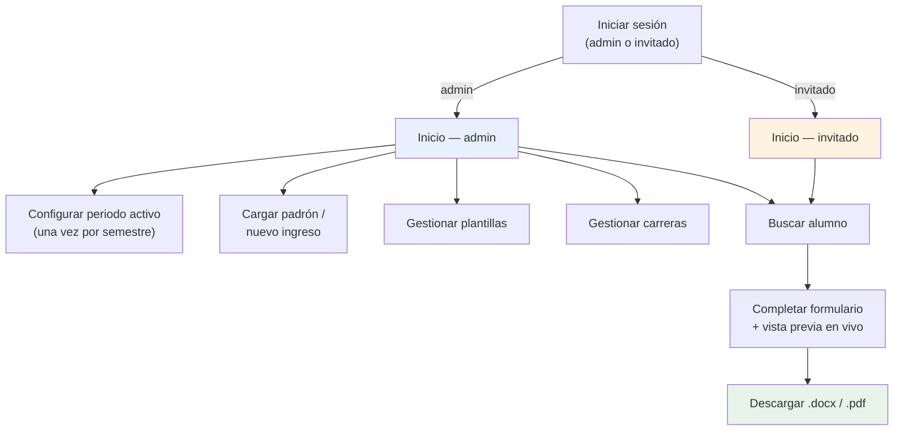

# Manual de usuario — Generador de Constancias

Guía para el personal del Centro Universitario UAEM Tianguistenco que usa esta herramienta para generar constancias escolares. Para detalles técnicos del sistema, ver [TECNICA.md](TECNICA.md).

## ¿Qué hace esta herramienta?

Genera constancias escolares (en Word `.docx` o PDF) llenando automáticamente el nombre, cuenta, carrera, semestre y otros datos del alumno, a partir de una plantilla ya diseñada por la escuela. Ya no hay que copiar y pegar datos a mano documento por documento.

## Roles

Hay dos tipos de acceso:

- **Administrador**: puede además cargar el padrón de alumnos, subir/editar plantillas, y dar de alta carreras nuevas.
- **Invitado**: solo puede buscar alumnos y generar constancias con lo que ya esté configurado.

## Primeros pasos (solo administrador, una vez por semestre)

1. **Configurar el periodo activo.** En la pantalla principal, en la tarjeta "Periodo activo", escribe el periodo en curso (ej. `2026A`) y, si las conoces, las fechas reales de inicio y fin del semestre. Esto es lo que permite que el sistema calcule solo el semestre de cada alumno y prellene las fechas en cada constancia. Si no lo configuras, esos campos saldrán vacíos y tendrás que llenarlos a mano en cada documento.

2. **Cargar el padrón de alumnos.** Ve a "Gestionar datos" → sube el archivo `.xls`, `.xlsx` o `.csv` con los alumnos (el que entrega control escolar). El archivo se queda guardado hasta que subas otro — no hay que volver a subirlo cada vez que alguien pida una constancia.

3. **(Opcional) Cargar alumnos de nuevo ingreso.** Si hay alumnos que todavía no están en el padrón principal (recién llegados de una preparatoria asociada, reinscritos después de mucho tiempo, o que cambiaron de carrera), en esa misma pantalla hay una sección aparte "Alumnos de nuevo ingreso" para subir ese Excel. El sistema los va a encontrar automáticamente al buscar, **pero solo si no existen ya en el padrón principal** — si algún día aparecen ahí, el sistema usa siempre el padrón principal y olvida el archivo de nuevo ingreso para esa cuenta, sin que tengas que hacer nada.

4. **Revisar plantillas.** En "Plantillas" puedes ver qué documentos están configurados (constancia general, en inglés, de prácticas, etc.), añadir uno nuevo, o reemplazar el actual descargándolo, editándolo en Word y volviéndolo a subir. Cada reemplazo guarda la versión anterior por si hay que recuperarla.

5. **Revisar carreras.** En "Carreras" se relaciona el código del plan de estudios (ej. `ICO`) con el nombre completo tal como debe aparecer impreso, y cuántos semestres dura. Si aparece una carrera nueva o cambia la duración de un plan, se da de alta ahí, sin ayuda de un programador.

## Generar una constancia (admin o invitado)

1. En la pantalla principal, escribe el **número de cuenta** o **parte del nombre** del alumno en el buscador y presiona Enter (o el atajo de teclado `/` para saltar directo al buscador desde cualquier parte de la página).
2. Si hay más de una plantilla disponible, elige el tipo de constancia.
3. Se abre el formulario con casi todo ya llenado: nombre, carrera, semestre, fechas del periodo. A la derecha se ve una **vista previa en vivo** del documento — cada cambio que hagas se refleja ahí en un par de segundos.
4. Revisa/completa lo que falte:
   - El **género** puede no venir marcado si el padrón no trae esa columna — selecciónalo a mano.
   - Las **líneas opcionales** (promedio, periodo vacacional, línea libre) tienen un interruptor: si lo apagas o las dejas vacías, esa línea desaparece por completo del documento final, en vez de imprimirse en blanco.
   - La barra de "comodines" sobre la línea libre te permite insertar un texto guardado de antes, o guardar el que acabas de escribir para reutilizarlo después.
5. Cuando esté todo correcto, descarga en **.docx** (para seguir editando en Word) o **.pdf** (listo para imprimir/enviar).

## Buscar por nombre cuando no tienes la cuenta a la mano

Si escribes texto en vez de un número, el sistema busca por nombre (no importan acentos ni mayúsculas) tanto en el padrón principal como en el archivo de nuevo ingreso, y te muestra una lista para elegir. Si el alumno aparece en ambas fuentes, se muestra una sola vez (gana el padrón principal).

## Panel de salud del padrón

En "Gestionar datos" hay un resumen rápido y de solo lectura: cuántos alumnos hay en total, a cuántos les falta la columna de género, y cuántos existen solo en el archivo de nuevo ingreso (todavía no en el padrón principal). Sirve para detectar de un vistazo si algo quedó mal cargado antes de que alguien pida una constancia y se dé cuenta a medias.

## Acciones que piden confirmación

Cualquier acción que borra algo (eliminar una plantilla, una carrera, un comodín, el archivo de nuevo ingreso, o reemplazar el padrón/una plantilla ya cargados) pide confirmación antes de ejecutarse — nunca se pierde información sin avisar primero. Para lo más delicado (eliminar una plantilla completa, con todo su historial) el sistema pide además escribir el nombre corto de la plantilla, como paso extra de seguridad.

## Accesibilidad

La aplicación respeta la preferencia de "reducir movimiento" del sistema operativo/navegador (las animaciones se acortan casi a cero), funciona completo con teclado, y todos los avisos y mensajes de error se anuncian también a lectores de pantalla.

## Preguntas frecuentes

**¿Por qué no aparece el semestre en letra de un alumno de nuevo ingreso?**
A propósito: el archivo de nuevo ingreso no siempre indica el semestre real del alumno en este plantel, así que el sistema prefiere dejarlo en blanco (para que lo llenes tú si aplica) en vez de calcular un número que podría estar mal.

**Subí el padrón por error, ¿pierdo lo que ya tenía?**
El sistema pide confirmación antes de reemplazarlo si ya había uno cargado, mostrando el nombre y cantidad de alumnos que se van a reemplazar, precisamente para evitar errores de este tipo.

**¿Puedo tener varias plantillas de constancia a la vez?**
Sí — "constancia general", "en inglés", "de prácticas profesionales", las que hagan falta. Aparecen como opción al generar, en cuanto las das de alta en "Plantillas".

**Cambié algo en la plantilla y ahora un dato sale mal, ¿cómo lo arreglo?**
En "Gestionar plantillas" puedes ver el historial de versiones anteriores y restaurar cualquiera con un clic — nunca se pierde la versión anterior al reemplazar.
