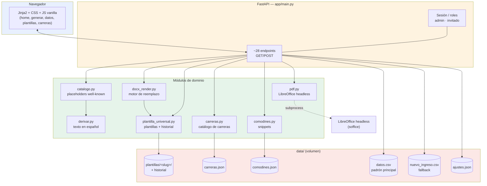
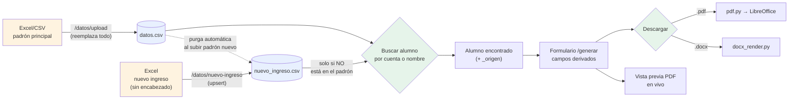
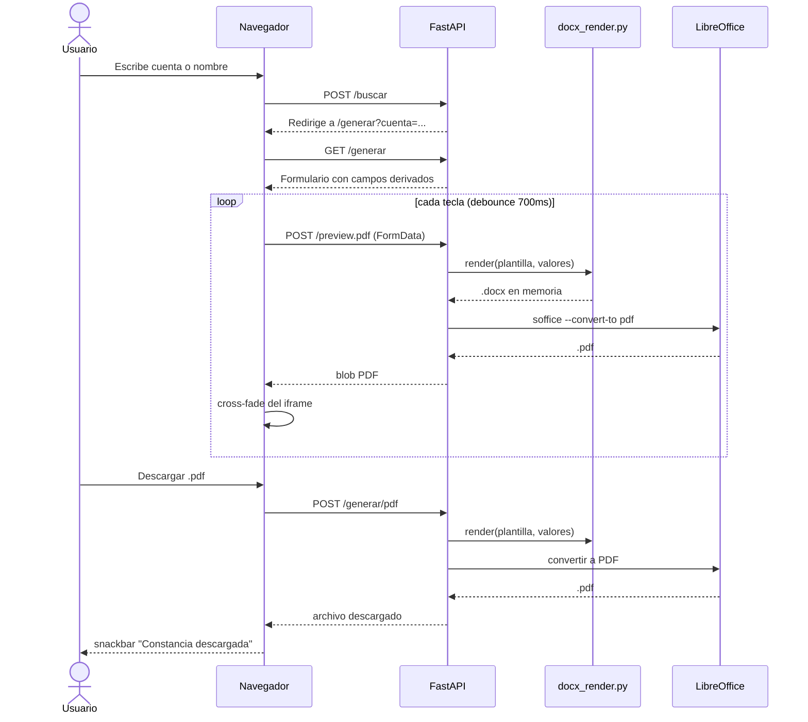

# Documentación técnica — Generador de Constancias UAEM Tianguistenco

Referencia para quien mantenga o extienda el código. Para el manual de uso diario, ver [MANUAL_USUARIO.md](MANUAL_USUARIO.md). Índice general en [INDEX.md](INDEX.md).

## 1. Visión general

Aplicación web monolítica en **FastAPI + Jinja2**, sin base de datos: todo el estado vive en archivos CSV/JSON planos bajo `data/` (montado como volumen Docker). Genera constancias escolares en `.docx` (vía `python-docx`) y `.pdf` (vía LibreOffice headless) a partir de una o varias plantillas con placeholders `[[CAMPO]]`.

Principios de diseño que se repiten en todo el código:

- **El nombre del placeholder decide su comportamiento.** No hace falta tocar código para agregar un campo nuevo a una plantilla: las convenciones de sufijo (`_LINEA`, `_FECHA`) y el catálogo `ETIQUETAS` en `catalogo.py` cubren la mayoría de los casos.
- **Nunca se pierde una versión.** Plantillas, padrón y ajustes se escriben de forma atómica (`.tmp` + `os.replace`) y las plantillas llevan historial con restauración de un clic.
- **Sin CDNs ni frameworks JS.** Todo el frontend es Jinja2 + CSS propio + JS vanilla, para minimizar dependencias en un proyecto de mantenedor único.

## 2. Arquitectura



### Módulos (`app/`)

| Archivo | Líneas | Responsabilidad |
|---|---|---|
| `main.py` | ~920 | Endpoints FastAPI, sesión/roles, orquestación de todos los flujos |
| `catalogo.py` | ~200 | Placeholders "well-known", convenciones por sufijo, derivación de valores por alumno |
| `docx_render.py` | ~210 | Detección y reemplazo de placeholders en cuerpo/tablas/headers/footers/cuadros de texto |
| `plantilla_universal.py` | ~350 | Gestión de plantillas con nombre: historial, cache autovalidada por mtime/tamaño |
| `derivar.py` | ~190 | Texto formal en español: fechas, semestre en letra, género, promedios |
| `carreras.py` | ~160 | Catálogo editable de carreras y duración de planes |
| `comodines.py` | ~50 | Snippets reutilizables para la línea libre, con lock de concurrencia |
| `pdf.py` | ~80 | Conversión `.docx` → `.pdf` vía `soffice --headless`, perfil temporal por invocación |

### Frontend (`app/templates/`, `app/static/`)

6 vistas Jinja2 (login, home, generar, datos, plantillas, carreras) + CSS Material Design 3 propio (`styles.css`, tokens de color/elevación/motion, modo oscuro por `data-theme`) + JS vanilla:

- `theme.js` — toggle de tema claro/oscuro.
- `tour.js` — tour guiado paso a paso por vista (`window.TOUR`).
- `ui.js` — infraestructura de UI compartida: `avisar()` (snackbars con `aria-live`), `confirmar()` (diálogos de confirmación con `<dialog>` nativo, soporta "escribir para confirmar"), `pedirTexto()`, `protegerFormulario()` (intercepta `submit`, valida, confirma, reenvía con `requestSubmit()`).

## 3. Modelo de datos (archivos, no BD)



### `data/datos.csv` — padrón principal

Columnas: `Cuenta, NombreAlumno, Plan, PerInicio, PrmGR, Per, Acr, Crd, Rpr, Sit, PrmAnual` (+ `Sexo` opcional). `NombreAlumno` sigue el formato `"APELLIDOS / NOMBRES"`. Se reemplaza por completo en cada subida (`guardar_datos`); las columnas se emparejan tolerando mayúsculas/acentos/espacios.

### `data/nuevo_ingreso.csv` — fallback de alumnos sin padrón

Se puebla desde un Excel **sin fila de encabezado real** (columnas posicionales: Cuenta, Apellido paterno, Apellido materno, Nombre(s), Plan, Periodo). Se consulta **solo** cuando la cuenta no aparece en el padrón principal — nunca se fusiona. Se purga automáticamente (en ambos sentidos) cuando una cuenta ya presente aparece en el otro archivo, para no dejar duplicados fantasma cuando un alumno avanza de semestre.

### `data/ajustes.json`

Periodo activo, fechas de inicio/fin de semestre, metadatos de la última carga de cada fuente (`datos_*`, `ni_*`).

### `data/carreras.json`, `data/comodines.json`, `data/plantillas/`

Catálogo de carreras editable desde `/carreras`; snippets de línea libre; una carpeta por plantilla (`universal.docx` + `_meta.json` con cache de placeholders + `historial/` con hasta 10 versiones respaldadas).

## 4. Flujo de generación de una constancia



Nota de rendimiento: `pdf.py` crea un perfil de usuario temporal de LibreOffice **en cada invocación** (no hay proceso `soffice` persistente), así que cada conversión tarda ~2-5s por el arranque en frío. La vista previa lo compensa con skeleton + mensajes escalonados, no con progreso granular (no hay infraestructura de streaming en el backend).

## 5. Sistema de placeholders

El nombre del placeholder en el `.docx` decide todo (`catalogo.py:tipo_de`):

| Convención | Comportamiento |
|---|---|
| `[[CUALQUIER_NOMBRE]]` | Input de texto libre |
| `[[ALGO_LINEA]]` / `[[LINEA_LIBRE]]` | Párrafo opcional: textarea + switch; si queda vacío, el párrafo se borra del `.docx` final |
| `[[ALGO_FECHA]]` | Selector de fecha → texto formal corto |
| Well-known (`NOMBRE_COMPLETO`, `CUENTA`, `CARRERA_FULL`, `SEMESTRE_TEXTO`, `SEMESTRES_TOTALES`, `PERIODO_INICIO/FIN`, `FECHA_EXPEDICION`, `ARTICULO`, `INTERESADO_FRASE`, `PROMEDIO_*_LINEA`, `PERIODO_VACACIONAL_LINEA`) | Etiqueta + control específico + valor prellenado, definidos en `ETIQUETAS` (`catalogo.py`) |

`docx_render.py` busca placeholders en cuerpo, tablas (incluso anidadas), headers/footers y cuadros de texto, y **une runs de Word partidos** antes de reemplazar (Word fragmenta el texto internamente al editar).

Para alumnos con `_origen == "nuevo_ingreso"`, `SEMESTRE_TEXTO` se deja vacío deliberadamente en vez de calcularse con `periodo_a_semestre`: el `PerInicio` de ese archivo no siempre representa el semestre real del alumno en este plantel (ver `catalogo.py`, comentario en `_derivar_well_known`).

## 6. Autenticación y roles

Pseudo-login con cookie **sin firmar** (`rol=admin|invitado`, `httponly`, `samesite=lax`) — es solo *gating de UI*, no seguridad real. `_bloquear_si_no_admin()` protege cada endpoint de administración (subir datos, plantillas, carreras, comodines). **No exponer el servicio a Internet sin un proxy con TLS + autenticación real** (Basic Auth, OAuth, etc.) — señalado también en el README.

## 7. Endpoints (`app/main.py`)

| Ruta | Método | Rol | Función |
|---|---|---|---|
| `/login`, `/logout` | GET/POST | — | Pseudo-sesión por cookie |
| `/` | GET | — | Home: búsqueda, estado, atajos por rol |
| `/ajustes` | POST | admin | Periodo activo y fechas del semestre |
| `/buscar` | POST | — | Búsqueda por cuenta o nombre (padrón + nuevo ingreso) |
| `/datos`, `/datos/upload` | GET/POST | admin | Padrón principal + panel de salud |
| `/datos/nuevo-ingreso`, `/datos/nuevo-ingreso/eliminar` | POST | admin | Archivo secundario de alumnos nuevos |
| `/plantillas`, `/plantillas/crear`, `/plantillas/{slug}/upload\|download\|restaurar\|eliminar` | GET/POST | admin (excepto download) | CRUD + historial de plantillas |
| `/carreras`, `/carreras/carrera*`, `/carreras/duracion*` | GET/POST | admin | Catálogo de carreras |
| `/comodines` | GET/POST/DELETE | admin (POST/DELETE) | Snippets de línea libre |
| `/generar` | GET | — | Formulario de una constancia |
| `/preview.pdf` | POST | — | Vista previa PDF en vivo |
| `/generar/docx`, `/generar/pdf` | POST | — | Descarga final |

## 8. Pruebas

`tests/` (pytest, `TestClient` de FastAPI, sin LibreOffice real — solo se prueba `.docx`): 76 casos cubriendo motor de render, gestión de plantillas, catálogo/derivación, carreras, y un flujo de API de punta a punta. Fixtures aíslan cada test con `tmp_path` + monkeypatch de las rutas de datos.

```powershell
python -m venv .venv
.venv\Scripts\pip install -r requirements-dev.txt
.venv\Scripts\python -m pytest tests -q
```

Dos tests (`test_nuevo_ingreso_*`) dependen de un Excel real gitignorado (`data/Alumnos de nuevo ingreso 26B.xlsx`) y se saltan automáticamente (`skipif`) si no está presente — no rompen CI/clones limpios.

## 9. Despliegue

Imagen Docker (`python:3.11-slim` + `libreoffice-writer`), variable `ADMIN_PASSWORD` para la contraseña de admin (default `admin2026`, **cambiar siempre** en producción), volumen `data/` para persistencia. Detalle completo de arranque/actualización/auto-inicio en Windows y Linux (systemd) en el [README](../README.md#ejecución).

## 10. Historial de decisiones relevantes

- **Generación por lotes eliminada.** Existió (`/lote`) pero no se usaba en la práctica; se retiró por completo (endpoints, template, tests, menciones en README) para reducir superficie de mantenimiento.
- **`nuevo_ingreso.csv` como archivo separado, no fusión.** `guardar_datos` trunca el padrón en cada subida; fusionar habría obligado a resubir el Excel de nuevo ingreso cada semestre. El fallback con purga automática resuelve el mismo problema sin ese costo.
- **Sin SSE ni progreso granular.** El cuello de botella real es el arranque en frío de LibreOffice (2-5s), no el parseo de Excel (decenas de ms para cientos de filas); implementar streaming de progreso no tendría beneficio proporcional a su costo para un mantenedor único.
