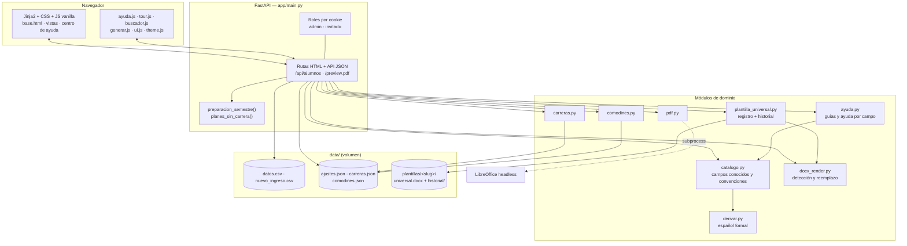
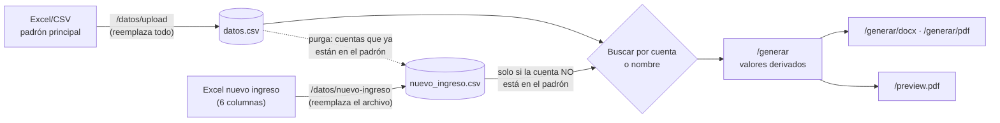
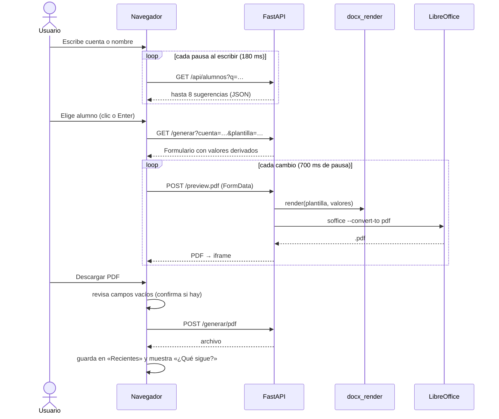

# Documentación técnica — Generador de Constancias UAEM Tianguistenco

Referencia para quien mantenga o extienda el código. Está escrita para alguien que llega al proyecto sin contexto: describe **qué hace cada pieza, por qué está hecha así y cómo cambiarla sin romper nada**.

- Uso diario del sistema: ayuda integrada (`/ayuda` y *Modo ayuda*) y [MANUAL_USUARIO.md](MANUAL_USUARIO.md).
- Instalar, actualizar, respaldar y resolver problemas en el servidor: [OPERACION.md](OPERACION.md).
- Lo que falta y en qué orden conviene hacerlo: [MEJORAS_FUTURAS.md](MEJORAS_FUTURAS.md).
- Índice general: [INDEX.md](INDEX.md).

> Esta documentación describe el código del commit en que se escribió. Cuando cambies el comportamiento, actualiza la sección correspondiente en el mismo commit: la documentación vieja es peor que no tener documentación.

## Contenido

1. [Visión general](#1-visión-general)
2. [Stack y dependencias](#2-stack-y-dependencias)
3. [Arquitectura y estructura de carpetas](#3-arquitectura-y-estructura-de-carpetas)
4. [Módulos del backend](#4-módulos-del-backend)
5. [Modelo de datos](#5-modelo-de-datos)
6. [Flujos principales](#6-flujos-principales)
7. [Motor de plantillas](#7-motor-de-plantillas)
8. [Reglas de negocio](#8-reglas-de-negocio)
9. [Frontend](#9-frontend)
10. [Sistema de ayuda integrado](#10-sistema-de-ayuda-integrado)
11. [Endpoints](#11-endpoints)
12. [Seguridad: modelo actual y límites](#12-seguridad-modelo-actual-y-límites)
13. [Rendimiento y concurrencia](#13-rendimiento-y-concurrencia)
14. [Pruebas](#14-pruebas)
15. [Recetas para cambios comunes](#15-recetas-para-cambios-comunes)
16. [Convenciones del código](#16-convenciones-del-código)
17. [Historial de decisiones](#17-historial-de-decisiones)

---

## 1. Visión general

Aplicación web monolítica en **FastAPI + Jinja2**, sin base de datos: todo el estado vive en archivos CSV/JSON/DOCX bajo `data/`, que en producción es un volumen Docker. Genera constancias escolares en `.docx` (con `python-docx`) y `.pdf` (con LibreOffice headless) a partir de una o varias **plantillas de Word** con campos `[[CAMPO]]`.

**Quién la usa:** personal administrativo de Servicios Escolares, sin perfil técnico. Dos roles: *invitado* (genera constancias) y *administrador* (además carga el padrón, plantillas, carreras y el periodo).

**Principios que se repiten en todo el código** (respétalos al extenderlo):

1. **El nombre del campo decide su comportamiento.** Agregar un dato a una constancia no requiere programar: se escribe `[[ALGO]]` en Word y el sistema lo detecta, lo muestra en el formulario y lo reemplaza. Los sufijos `_LINEA` y `_FECHA` cambian el control y el formato (§7).
2. **Nunca se pierde información por accidente.** Escrituras atómicas (`.tmp` + `os.replace`), validación de archivos *antes* de reemplazar lo que funciona, historial de plantillas y confirmación en toda acción destructiva.
3. **Tolerar lo que hacen las personas y Word.** Encabezados de Excel con otra capitalización o acentos, cuentas como `2014694.0`, placeholders partidos en varios *runs*, `[[ nombre ]]` con espacios: todo se normaliza.
4. **La ayuda vive junto a lo que explica.** Un solo texto alimenta el modo ayuda y el recorrido guiado; lo que depende de datos (campos, carreras) se genera del código (§10).
5. **Sin CDNs ni frameworks de JS.** Jinja2 + CSS propio + JS vanilla: menos dependencias que se vuelvan obsoletas en un proyecto de un solo mantenedor.

---

## 2. Stack y dependencias

| Pieza | Uso | Versión probada* |
|---|---|---|
| Python | Lenguaje | 3.11 (imagen Docker) · 3.13 (desarrollo local) |
| FastAPI / Starlette | Servidor web, rutas, formularios, archivos | 0.162 / 1.10 |
| Uvicorn | Servidor ASGI | 0.54 |
| Jinja2 | Plantillas HTML | 3.1 |
| python-docx (+ lxml) | Leer y escribir `.docx` | 1.2 |
| pandas (+ openpyxl, xlrd) | Leer Excel/CSV del padrón | 3.1 / 3.1 / 2.0 |
| num2words | Números en letra («dos mil veintiséis») | 0.5 |
| python-multipart | Subida de archivos | 0.0.33 |
| LibreOffice Writer | `.docx` → `.pdf` (`soffice --headless`) | paquete `libreoffice-writer` de Debian |
| pytest, httpx | Pruebas | 9.2 / 0.28 |

\* `requirements.txt` **no fija versiones**: cada `docker build` instala las más recientes. Es un riesgo de largo plazo (una versión nueva de pandas o python-docx puede romper algo sin que cambie el código). Fijarlas es la primera mejora recomendada en [MEJORAS_FUTURAS.md](MEJORAS_FUTURAS.md).

---

## 3. Arquitectura y estructura de carpetas



```
constancias-uaem-tianguistenco/
├── Dockerfile                  python:3.11-slim + libreoffice-writer + fuentes
├── requirements.txt            dependencias de ejecución (sin versiones fijas)
├── requirements-dev.txt        + pytest, httpx
├── app/
│   ├── main.py                 rutas, roles, padrón, ajustes, preparación del semestre
│   ├── catalogo.py             campos conocidos (ETIQUETAS), convenciones, valores iniciales
│   ├── derivar.py              fechas, números, semestre, género y promedios en español
│   ├── docx_render.py          detectar y reemplazar [[CAMPOS]] en el .docx
│   ├── plantilla_universal.py  plantillas con nombre, cache, historial, migración
│   ├── carreras.py             catálogo editable de carreras y duraciones
│   ├── comodines.py            frases guardadas para la línea libre
│   ├── pdf.py                  conversión con LibreOffice
│   ├── ayuda.py                índice de guías, ayuda por campo, referencia de campos
│   ├── bootstrap_plantillas/   plantilla inicial (y «plantilla de ejemplo» de /ayuda)
│   ├── templates/
│   │   ├── base.html           esqueleto común (barra, encabezado, pie, scripts)
│   │   ├── _macros.html        icono(), ayuda(), aviso()
│   │   ├── login · home · generar · datos · plantillas · carreras .html
│   │   └── ayuda/              index.html, articulo.html, articulos/<slug>.html
│   └── static/                 styles.css, *.js, fonts/
├── tests/                      pytest
├── docs/                       esta documentación
└── data/                       estado (gitignorado salvo carpetas vacías)
```

---

## 4. Módulos del backend

### `main.py` (~1100 líneas)

Orquesta todo. Secciones, en orden dentro del archivo:

| Sección | Funciones clave | Notas |
|---|---|---|
| Rutas de archivos | `DATA_DIR`, `PLANTILLAS_DIR`, `TMP_DIR`, `DATOS_CSV`… | Todas derivan de `app/../data`. Las pruebas las reasignan (§14). |
| App y arranque | `_lifespan` | Al arrancar: vacía `data/tmp/` y siembra la plantilla inicial si no hay ninguna. |
| Jinja | `templates.env.globals["V"]`, `ayuda_campo`, filtros `nombre_legible`, `fecha_legible` | `V` es la versión de estáticos (§9). |
| Roles | `get_rol`, `es_admin`, `_bloquear_si_no_admin` | Ver §12. |
| Ajustes | `cargar_ajustes`, `guardar_ajustes` | `ajustes.json`, escritura atómica. |
| Padrón | `guardar_datos`, `leer_datos`, `_normalizar_columnas`, `buscar_alumno`, `buscar_por_nombre` | Lee el CSV completo en cada búsqueda (§13). |
| Nuevo ingreso | `guardar_nuevo_ingreso`, `_purgar_nuevo_ingreso`, `eliminar_nuevo_ingreso` | Archivo de respaldo (§8.6). |
| Salud | `panel_salud` | Números para `/datos`. |
| Generación | `_plantilla_de`, `_form_a_valores`, `_generar_y_servir` | Renderiza, convierte y programa el borrado de temporales. |
| Preparación del semestre | `planes_sin_carrera`, `preparacion_semestre` | Lista de verificación de Inicio (§6.4). |
| API | `api_alumnos` | Sugerencias del buscador. |
| Centro de ayuda | `ayuda_index`, `ayuda_articulo`, `ayuda_plantilla_ejemplo` | Rutas públicas. |

### `catalogo.py`

Fuente única de verdad sobre **cómo se comporta cada campo**:

- `ETIQUETAS`: campos conocidos → etiqueta y tipo de control (`text`, `textarea`, `date_corto`, `date_largo`, `date_rango`, `radio_genero`, `hidden`). Su orden es el orden en que aparecen en el formulario.
- `tipo_de(nombre)`: tipo de cualquier campo, conocido o inventado (convenciones `_LINEA`/`LINEA_LIBRE` → `textarea` opcional, `_FECHA` → `date_corto`, resto → `text`). La usan **tanto** el formulario como el parseo del POST, así nunca se desincronizan.
- `_derivar_well_known(alumno, ajustes, carreras)`: valores iniciales calculados (nombre, carrera, semestre, fechas, género, promedios).
- `construir_campos_form(...)`: lista lista para pintar. `main.generar_page` la reordena: género primero, luego orden de `ETIQUETAS`, luego campos propios de la plantilla.

### `derivar.py`

Funciones puras (sin estado) que producen el español formal de la constancia. Todas están cubiertas por pruebas. Ver §8 para las reglas.

### `docx_render.py`

Ver §7. `analizar_plantilla(path) -> (placeholders, avisos)` y `render(path, valores, opcionales_vacios) -> Document`.

### `plantilla_universal.py`

- `PlantillaUniversal(carpeta)`: una plantilla. `info()` devuelve placeholders/avisos desde `_meta.json` **revalidado contra tamaño y mtime del .docx**: si alguien edita el archivo directamente en disco, se re-escanea solo. `replace(bytes)` valida en un temporal (debe abrir y tener **al menos un placeholder**), respalda la actual en `historial/` (máximo `HISTORIAL_MAX = 10`) y reemplaza atómicamente. `restaurar(nombre)` reutiliza `replace`, así que también respalda.
- `RegistroPlantillas(base)`: varias plantillas con nombre en `registro.json`. Slugs a partir del nombre (`_slug_de`), únicos con sufijo `-2`, `-3`. No permite eliminar la última. Migra solo el layout antiguo (un `universal.docx` suelto). `seed_si_vacio` instala `bootstrap_plantillas/universal.docx` como «Constancia general».

### `carreras.py`

Catálogo en `carreras.json`, sembrado desde `CARRERAS_SEED` / `DURACIONES_SEED` si el archivo no existe. Carreras por **prefijo** del plan (`ICO` de `ICO-F19`), duraciones por **código completo** (`IPI-F26`). Los nombres se guardan en MAYÚSCULAS. Lock + escritura atómica.

### `comodines.py`

Frases guardadas (`[{id, titulo, texto}]`). Tiene lock, pero **su escritura no es atómica** (escribe directo sobre el JSON). Ver mejoras.

### `pdf.py`

`docx_a_pdf(docx, out_dir, timeout=30)`: busca `soffice` en el PATH y en rutas típicas de Windows/Linux, crea un **perfil de LibreOffice temporal por conversión** (permite conversiones en paralelo sin bloqueos de perfil) y lanza `ConversionError` con stdout/stderr si falla.

### `ayuda.py`

`ARTICULOS`, `CATEGORIAS`, `AYUDA_CAMPOS`, `ayuda_campo()`, `referencia_campos()`. Ver §10.

---

## 5. Modelo de datos

Todo vive en `data/`. **No hay base de datos.** Para respaldar el sistema basta con copiar esta carpeta (ver [OPERACION.md](OPERACION.md#respaldos)).



| Archivo | Formato | Quién escribe | Contenido |
|---|---|---|---|
| `datos.csv` | CSV (todo texto) | `guardar_datos` | Padrón tal como se subió, con columnas canónicas renombradas: `Cuenta` (obligatoria), `NombreAlumno` («APELLIDOS / NOMBRES»), `Plan`, `PerInicio`, `PrmGR`, `Per`, `Sit`, `Sexo` y cualquier otra columna original. |
| `nuevo_ingreso.csv` | CSV | `guardar_nuevo_ingreso` | `Cuenta, NombreAlumno, Plan, PerInicio` (derivados de las 6 columnas posicionales del Excel). |
| `ajustes.json` | JSON | `/ajustes` y las cargas | Ver abajo. |
| `carreras.json` | JSON | `carreras.py` | `{"carreras": {"ICO": "…"}, "duraciones": {"IPI-F26": 9}, "duracion_default": 10}` |
| `comodines.json` | JSON | `comodines.py` | `[{"id": "a1b2c3d4", "titulo": "…", "texto": "…"}]` |
| `plantillas/registro.json` | JSON | `RegistroPlantillas` | `{"<slug>": {"nombre": "Constancia general"}}` |
| `plantillas/<slug>/universal.docx` | DOCX | `PlantillaUniversal.replace` | Plantilla activa. |
| `plantillas/<slug>/_meta.json` | JSON | `_refresh_meta` | `{"filename", "placeholders": [...], "avisos": [...], "fecha_carga", "size", "mtime_ns"}` (cache, se puede borrar) |
| `plantillas/<slug>/historial/universal_AAAAMMDD_HHMMSS[-n].docx` | DOCX | `_respaldar_actual` | Últimas 10 versiones. |
| `tmp/` | — | generación y subidas | Temporales. Se vacía al arrancar y cada archivo se borra al terminar su respuesta. |

**`ajustes.json`**

```json
{
  "periodo_actual": "2026B",
  "periodo_fecha_inicio": "2026-08-03",
  "periodo_fecha_fin": "2027-01-29",
  "datos_filename": "padron 26B.xlsx",
  "datos_fecha_carga": "2026-08-05T10:12:40",
  "datos_filas": 1432,
  "datos_sexo_usa_h": true,
  "ni_filename": "Alumnos de nuevo ingreso 26B.xlsx",
  "ni_fecha_carga": "2026-08-06T09:01:12",
  "ni_filas": 210,
  "ni_periodo": "2026B"
}
```

`datos_sexo_usa_h` se decide una vez por padrón: si la columna Sexo contiene valores que empiezan con «H», una «M» significa *Mujer*; si no, *Masculino* (§8.4).

**En el navegador** (`localStorage`, por equipo y navegador; nunca llega al servidor): `theme` (claro/oscuro), `tour_seen_<clave>` (recorridos ya vistos), `constancias_recientes` (últimas 6 constancias descargadas).

---

## 6. Flujos principales

### 6.1 Buscar y generar



Sin JavaScript, el formulario de búsqueda sigue funcionando: `POST /buscar` redirige a `/generar` (si son dígitos y existe la cuenta) o a `/?nombre=…` con la lista de resultados.

**Cómo se arman los valores** (`_form_a_valores`): por cada placeholder de la plantilla, `catalogo.tipo_de` decide si leer `fecha_<NOMBRE>` (fechas, se convierten a texto), `fecha_VAC_INICIO/FIN` (rango vacacional) o `campo_<NOMBRE>` (texto). El género (`__genero__`) deriva `ARTICULO` e `INTERESADO_FRASE`. Las líneas opcionales apagadas llegan **deshabilitadas** (el navegador no las envía), quedan vacías y `render` elimina su párrafo.

### 6.2 Subir el padrón

`POST /datos/upload` → guarda el archivo en `tmp/` → `guardar_datos`: lee con pandas (todo como texto), normaliza encabezados (`_clave_columna`: sin acentos, minúsculas, solo alfanuméricos), exige `Cuenta`, rechaza archivo vacío, normaliza cuentas (`2014694.0` → `2014694`), decide el esquema de Sexo, escribe `datos.csv` atómicamente, actualiza `ajustes.json` y **purga** de `nuevo_ingreso.csv` las cuentas que ya aparecen. Cualquier error → `ValueError` → redirección con `?error=` y los datos anteriores intactos.

### 6.3 Ciclo de vida de una plantilla

```mermaid
stateDiagram-v2
    [*] --> Activa: crear (valida .docx y ≥1 campo)
    Activa --> Activa: reemplazar → la anterior va a historial/
    Activa --> Activa: restaurar versión → la actual va a historial/
    Activa --> Activa: edición directa en disco → _meta.json se re-escanea
    Activa --> [*]: eliminar (no si es la única; borra historial)
```



Editar el `.docx` directamente en `data/plantillas/<slug>/` funciona (el cache se revalida), pero **no deja respaldo en el historial**: para cambios normales, usar la interfaz.

### 6.4 Preparación del semestre

`preparacion_semestre(ajustes, plantillas)` se calcula en cada visita de un administrador a Inicio. Cuatro pasos con estado `ok` / `parcial`:

| Paso | `ok` cuando… | `parcial` cuando… |
|---|---|---|
| Periodo activo y fechas | hay `periodo_actual` | faltan las fechas reales |
| Padrón | existe `datos.csv` | — |
| Plantillas | hay al menos una utilizable | alguna tiene avisos de campos mal escritos |
| Carreras del padrón | todos los prefijos de `Plan` están en el catálogo (`planes_sin_carrera`) | — |

---

## 7. Motor de plantillas

**Convenciones de nombre** (`catalogo.tipo_de`). El nombre del campo decide todo; ninguna requiere tocar código:

| En el `.docx` | En el formulario | Al generar |
|---|---|---|
| `[[CUALQUIER_NOMBRE]]` | Casilla de texto, etiqueta derivada del nombre, marcada «de la plantilla» | El texto tal cual |
| `[[ALGO_LINEA]]` o `[[LINEA_LIBRE]]` | Área de texto con interruptor Incluida/Omitida | Si queda vacía o apagada, el párrafo desaparece |
| `[[ALGO_FECHA]]` | Calendario | «02 de febrero de 2026» |
| Campo conocido (`ETIQUETAS`: `NOMBRE_COMPLETO`, `CUENTA`, `CARRERA_FULL`, `SEMESTRE_TEXTO`, `SEMESTRES_TOTALES`, `PERIODO_INICIO`, `PERIODO_FIN`, `FECHA_EXPEDICION`, `ARTICULO`, `INTERESADO_FRASE`, `PROMEDIO_GENERAL_LINEA`, `PROMEDIO_ULTIMO_LINEA`, `PROMEDIO_PERIODO_LINEA`, `PERIODO_VACACIONAL_LINEA`, `LINEA_LIBRE`) | Control específico, prellenado | Valor derivado (§8) o editado |

La lista completa con ejemplos reales está en la guía integrada `/ayuda/campos-de-plantilla`, generada por `ayuda.referencia_campos()`.

**Detección** (`analizar_plantilla`). Recorre **todos** los párrafos: cuerpo, tablas (recursivo, incluye anidadas), encabezados y pies (normal, primera página, páginas pares) y cuadros de texto (`w:txbxContent`, que python-docx no expone y Word usa en membretes). Regex: `\[\[\s*([A-Za-z0-9_ÁÉÍÓÚÜÑáéíóúüñ]+)\s*\]\]`. Nombres normalizados a MAYÚSCULAS. Si al quitar los placeholders válidos sobra `[[` o `]]`, el párrafo se reporta como aviso con un extracto, para que el administrador sepa qué corregir.

**Reemplazo** (`render`). Word parte el texto en *runs* (fragmentos con formato) de forma impredecible; un placeholder puede quedar repartido en tres. Para cada párrafo se une el texto de los runs, se localizan los placeholders y se reemplazan **de derecha a izquierda** tocando solo los runs involucrados (`_reemplazar_span`): el valor queda con el formato del primer run del placeholder y el resto del párrafo conserva el suyo. Un valor que contenga `[[X]]` no se vuelve a procesar.

**Líneas opcionales.** Si un párrafo consiste **solo** en un placeholder opcional (`_LINEA`, `LINEA_LIBRE`) y su valor está vacío, el párrafo se elimina. En celdas de tabla se vacía en lugar de borrarse (una celda `.docx` necesita al menos un párrafo). Si el placeholder opcional comparte párrafo con otro texto, **no** se elimina el párrafo: solo se reemplaza por vacío.

**Placeholders desconocidos:** si la plantilla tiene `[[ALGO]]` que no está en `ETIQUETAS`, aparece como campo de texto en el formulario (marcado «de la plantilla») y se reemplaza con lo que se escriba.

---

## 8. Reglas de negocio

### 8.1 Semestre

`periodo_a_semestre(per_inicio, per_actual) = índice(actual) − índice(inicio) + 1`, con `índice(AAAAX) = AAAA·2 + (1 si X = B)`. Ejemplo: ingresó 2023B, periodo 2026A → 6 → «sexto».

- Cuenta periodos transcurridos, **no** avance académico: bajas temporales o reprobación no se reflejan. El usuario puede corregirlo en el formulario.
- Ordinales hasta 12 (`ORDINALES`), escritos sin acento («septimo», «decimo») por coincidir con la constancia original; más allá de 12, cadena vacía.
- Para alumnos de **nuevo ingreso** se calcula igual, usando la columna Periodo de su archivo como `PerInicio`.

### 8.2 Fechas

- `fecha_a_texto_corto`: «02 de febrero de 2026» (fechas de periodo y campos `_FECHA`).
- `fecha_a_texto_largo`: «a los seis días del mes de febrero del año dos mil veintiséis»; el día 1 es «al primer día…» (fecha de expedición).
- Fechas del periodo: las guardadas en ajustes; si faltan, `fechas_default_periodo`: A = 02 feb → 02 ago; B = 02 ago → 02 feb del año siguiente.
- Periodo vacacional: mismo mes → «a partir del 20 al 31 de julio del 2026.»; distinto mes → con fechas cortas completas.

### 8.3 Nombre

`formato_nombre`: quita la diagonal y espacios dobles del formato del padrón: «PÉREZ LÓPEZ / JUAN» → «PÉREZ LÓPEZ JUAN» (apellidos primero, tal como viene).

### 8.4 Género

`normalizar_genero` acepta M/F, H/M, MASCULINO/FEMENINO, HOMBRE/MUJER, VARÓN. La «M» sola es ambigua y se resuelve con `datos_sexo_usa_h`. `articulo_de` → «el alumno / la alumna»; `interesado_frase` → «del interesado / de la interesada». En el formulario, sin género elegido no se permite descargar.

### 8.5 Promedios

«Promedio general 8.6 (ocho punto seis)». `decimal_a_letra` lee los decimales como entero (8.45 → «ocho punto cuarenta y cinco»; 8.50 → «ocho punto cinco»; 10.0 → «diez»). Acepta coma decimal; valores no numéricos dejan la línea vacía.

### 8.6 Nuevo ingreso

Respaldo para alumnos que aún no están en el padrón. Excel de **exactamente 6 columnas** posicionales (Cuenta, Paterno, Materno, Nombres, Plan, Periodo), sin encabezado (si la primera fila no tiene cuenta numérica se descarta), filas con 3+ celdas vacías ignoradas, cuentas duplicadas → la última gana. Solo se consulta si la cuenta no está en `datos.csv`; nunca se fusiona. Se purga al subir un padrón (y al subir el propio archivo, contra el padrón existente).

### 8.7 Carreras

`carrera_full(plan)`: prefijo antes del guion → nombre del catálogo; si no existe, devuelve el plan crudo (se ve en la constancia y lo detecta la preparación del semestre). `semestres_totales(plan)`: duración por código completo o `duracion_default` (10).

---

## 9. Frontend

### Plantillas Jinja

Todas las vistas extienden **`base.html`**, que aporta: enlace «Saltar al contenido», barra superior (marca, navegación según rol, *Modo ayuda*, *Guías*, tema, sesión), encabezado de página, pie y scripts comunes. Bloques que llena cada vista:

| Bloque | Uso |
|---|---|
| `titulo` | `<title>` y `<h1>` |
| `subtitulo` | Línea bajo el título (puede tener HTML) |
| `migas` | Encima del título (pasos o ruta) |
| `acciones_pagina` | Botones a la derecha del encabezado |
| `contenido` | Cuerpo |
| `head`, `scripts` | CSS/JS propios |
| `recorrido` | Clave del recorrido guiado; vacío = sin recorrido |
| `ancho` | `""` (1000 px), `page--angosta` (820), `page--ancha` (1400) |

**`_macros.html`**: `icono(nombre, clase="")` (SVG inline desde el diccionario `_ICONOS`; agrega ahí los nuevos), `ayuda(titulo, texto, articulo="", paso=0)` (§10) y `aviso(tipo)` usado con `` (`info`, `exito`, `error`, `alerta`).

**Filtros y globales**: `V` (versión de estáticos), `ayuda_campo(nombre)`, `| nombre_legible`, `| fecha_legible` («10 nov 2026, 23:44»).

### JavaScript (`app/static/`)

Todo vanilla, un IIFE por archivo, sin dependencias:

| Archivo | Responsabilidad | API pública |
|---|---|---|
| `theme.js` | Tema claro/oscuro (botón `#themeToggle`), efecto *ripple* | — |
| `ui.js` | Snackbars, diálogos accesibles, confirmación declarativa de formularios (`<form data-confirmar data-confirmar-titulo=… data-confirmar-peligro data-confirmar-escribir-para=…>`), zonas para soltar archivos (`<label class="dropzone">`), constancias recientes | `avisar(msg, tipo)`, `confirmar(opts)`, `pedirTexto(opts)`, `protegerFormulario(form, opts)`, `recientes.{listar,agregar,borrar}` |
| `ayuda.js` | Modo ayuda | `modoAyuda.{activar,desactivar}` |
| `tour.js` | Recorrido guiado | `iniciarRecorrido()` |
| `buscador.js` | Inicio: sugerencias (combobox ARIA), atajo `/`, recientes | — |
| `generar.js` | Vista previa, interruptores, revisión de campos, descarga, diálogo final, frases guardadas, `Ctrl+Enter` | lee `window.GENERAR` |

### CSS

Un solo `styles.css`. Arriba, **tokens** en `:root` (colores Material 3 a partir del verde Pantone 350 C `#2C5234` y oro Pantone 112 C `#9C8412`, radios, sombras, duraciones) y su versión oscura en `html[data-theme="dark"]`. Los componentes usan solo tokens: para cambiar la paleta institucional basta con editar los tokens. Secciones marcadas con `/* ---------- Nombre ---------- */`; lo agregado en el rediseño está bajo el bloque «v11». `prefers-reduced-motion` anula animaciones; hay estilos de impresión para las guías.

**Caché**: las vistas cargan `styles.css?v={{ V }}`. **Al cambiar cualquier CSS o JS, sube `V` en `main.py`**; si no, los navegadores siguen usando la copia vieja.

### Accesibilidad (convenciones a mantener)

- Todo control tiene nombre accesible (label, `aria-label` o texto oculto con `.sr-only`); los íconos son `aria-hidden`.
- Diálogos con `<dialog>` nativo; avisos dinámicos en regiones `aria-live`.
- Buscador con patrón combobox (`role="combobox"`, `aria-activedescendant`, `role="listbox"`).
- Objetivos táctiles ≥ 44 px en controles principales; sin desbordamiento horizontal a 375 px.
- La ayuda está siempre en el mismo lugar (WCAG 2.2, *Consistent Help*).

---

## 10. Sistema de ayuda integrado

Objetivo: que nadie dependa de un manual externo y que el texto de ayuda **no se contradiga con el tiempo**.

| Pieza | Dónde | Qué hace |
|---|---|---|
| Macro `ayuda(titulo, texto, articulo="", paso=0)` | `_macros.html`, en cada vista | Pone `data-ayuda`, `data-ayuda-texto`, `data-ayuda-articulo` y `data-recorrido` en un elemento. |
| Modo ayuda | `ayuda.js` | Botón *Modo ayuda* o tecla `?`. Marca cada `[data-ayuda]` visible con un «?», muestra el título al pasar el cursor y, al hacer clic, una tarjeta navegable (‹ ›, flechas, `Esc`) con enlace a la guía. Mientras está activo, los clics y envíos de formularios **dentro de las zonas no se ejecutan**. `?ayuda=1` abre la pantalla ya en modo ayuda. Los elementos con `data-ayuda-exento` no se interceptan (botón de tema, el propio botón). |
| Recorrido guiado | `tour.js` | Toma los elementos con `data-recorrido` en orden numérico y añade un último paso que señala *Modo ayuda*. Arranca solo la primera vez por pantalla y navegador (`tour_seen_<clave>`); también con `iniciarRecorrido()` o `?recorrido=1`. |
| Índice de guías | `ayuda.py: ARTICULOS, CATEGORIAS` | slug, categoría, título, resumen, palabras clave para el buscador, `solo_admin`, botón «Ir a la pantalla». |
| Cuerpo de guías | `templates/ayuda/articulos/<slug>.html` | Jinja con contexto `campos`, `catalogo`, `columnas_padron`. Componentes CSS: `ol.pasos`, `div.consejo(--atencion)`, `table.tabla`, `details.faq` (se abre si la URL trae `#id`), `div.word-mock` + `span.ph-demo`, `dl.glosario`. |
| Ayuda por campo | `ayuda.py: AYUDA_CAMPOS, ayuda_campo()` | Texto del modo ayuda en cada campo de `/generar`; los campos inventados reciben un texto según su convención. |
| Referencia de campos | `ayuda.py: referencia_campos()` | Tabla de la guía «Referencia de campos», con ejemplos calculados con `derivar.py`. |

Reglas:

- **Un texto, un lugar.** El texto de una zona se escribe en su `ayuda(...)`; el recorrido lo reutiliza.
- **Cambia la clave del recorrido** (bloque `recorrido`, p. ej. `home-admin-v2` → `-v3`) cuando cambien mucho los pasos de una pantalla, para que todos lo vean otra vez.
- Las rutas de ayuda son **públicas** (no muestran datos de alumnos).

---

## 11. Endpoints

| Ruta | Método | Acceso real | Función |
|---|---|---|---|
| `/login` | GET, POST | público | Elegir rol; admin valida `ADMIN_PASSWORD` y pone la cookie `rol` |
| `/logout` | POST | público | Borra la cookie |
| `/` | GET | con sesión | Inicio: buscador, resultados por nombre, preparación del semestre (admin) o estado (invitado) |
| `/buscar` | POST | **sin verificación** | Redirige a `/generar` o a resultados por nombre |
| `/api/alumnos?q=` | GET | con sesión (401 si no) | Hasta 8 sugerencias `{cuenta, nombre, plan, nuevo_ingreso}`; prefijo de cuenta si `q` son dígitos, nombre en otro caso; `q` < 2 caracteres → `[]` |
| `/ajustes` | POST | admin | Periodo y fechas; rechaza fin < inicio |
| `/datos` | GET | admin | Resumen y salud del padrón |
| `/datos/upload` | POST | admin | Reemplaza el padrón |
| `/datos/nuevo-ingreso` | POST | admin | Reemplaza el archivo de nuevo ingreso |
| `/datos/nuevo-ingreso/eliminar` | POST | admin | Borra el archivo de nuevo ingreso |
| `/plantillas` | GET | admin | Lista con campos, avisos e historial |
| `/plantillas/crear` | POST | admin | Nueva plantilla (`nombre`, `archivo`) |
| `/plantillas/{slug}/upload` | POST | admin | Reemplaza (respalda la anterior) |
| `/plantillas/{slug}/download` | GET | admin | Descarga el .docx activo |
| `/plantillas/{slug}/restaurar` | POST | admin | Restaura `nombre` del historial |
| `/plantillas/{slug}/eliminar` | POST | admin | Elimina (no la última) |
| `/carreras` | GET | admin | Catálogo + planes sin carrera |
| `/carreras/carrera`, `/carreras/carrera/eliminar` | POST | admin | Alta/edición/baja de carrera |
| `/carreras/duracion`, `/carreras/duracion/eliminar` | POST | admin | Alta/baja de duración de plan |
| `/comodines` | GET, POST | **sin verificación** | Listar / crear frase guardada |
| `/comodines/{id}` | DELETE | **sin verificación** | Eliminar frase guardada |
| `/generar?cuenta=&plantilla=` | GET | **sin verificación** | Formulario (muestra datos del alumno) |
| `/preview.pdf` | POST | **sin verificación** | Vista previa |
| `/generar/docx`, `/generar/pdf` | POST | **sin verificación** | Descarga `Constancia_<cuenta>.<ext>` |
| `/ayuda`, `/ayuda/{slug}` | GET | público | Centro de ayuda; slug desconocido → `/ayuda` |
| `/ayuda/plantilla-ejemplo.docx` | GET | público | Plantilla inicial como base |
| `/static/*` | GET | público | CSS, JS, fuentes |

Las rutas marcadas **sin verificación** funcionan aunque no haya sesión. Ver §12.

---

## 12. Seguridad: modelo actual y límites

El sistema está pensado para una **red interna de confianza**. Su control de acceso es una comodidad de interfaz, no una barrera:

| Punto | Estado actual | Consecuencia |
|---|---|---|
| Sesión | Cookie `rol=admin|invitado`, `httponly`, `samesite=lax`, **sin firma** | Cualquiera puede fijarse `rol=admin` a mano y administrar. |
| Contraseña | Una sola, en `ADMIN_PASSWORD`; por defecto `admin2026` (publicada en el README) | Si no se cambia al desplegar, cualquiera la conoce. |
| Generación | `/generar`, `/preview.pdf`, `/generar/*`, `/buscar` sin verificación de rol | Quien llegue al puerto puede consultar datos de alumnos por número de cuenta. |
| Frases guardadas | `/comodines` sin verificación | Cualquiera puede crear o borrar frases. |
| CSRF | Sin token; mitigado parcialmente por `samesite=lax` | — |
| Subidas | Sin límite de tamaño; se validan formato y contenido | Un archivo enorme ocupa memoria y disco. |
| Datos personales | Padrón en CSV plano sin cifrar en `data/` | Proteger el equipo y los respaldos; aplica la Ley Federal de Protección de Datos Personales en Posesión de los Particulares / normativa universitaria. |
| Bitácora | No hay registro de quién generó qué | No hay trazabilidad. |

**Reglas de despliegue mientras esto no cambie:** no exponer el puerto a Internet; solo en la red interna o detrás de un proxy con TLS y autenticación real; cambiar siempre `ADMIN_PASSWORD`. Las mejoras concretas están priorizadas en [MEJORAS_FUTURAS.md](MEJORAS_FUTURAS.md#1-seguridad-y-datos-personales).

---

## 13. Rendimiento y concurrencia

- **LibreOffice** es el cuello de botella: arranque en frío por conversión, 1–5 s, ~150 MB. Cada vista previa es una conversión completa.
- **Las rutas de generación son `async def` pero llaman código bloqueante** (`subprocess.run` de LibreOffice, pandas). Con un solo proceso de Uvicorn, mientras se convierte un PDF **el servidor no atiende otras peticiones**. Con 1–2 personas no se nota; con varias ventanillas simultáneas sí. Arreglo sencillo descrito en mejoras.
- **Búsqueda:** cada consulta (incluida cada sugerencia mientras se escribe) lee el CSV completo con pandas. Para unos pocos miles de alumnos son decenas de milisegundos; con más conviene cachear por `mtime`.
- **Plantillas:** el escaneo de placeholders se cachea en `_meta.json` y se revalida por tamaño + mtime.
- Temporales: un UUID por petición en `tmp/`, borrados con `BackgroundTasks` y al arrancar.

---

## 14. Pruebas

```powershell
python -m venv .venv
.venv\Scripts\pip install -r requirements-dev.txt
.venv\Scripts\python -m pytest tests -q
```

82 casos (80 se ejecutan siempre; 2 requieren el Excel real `data/Alumnos de nuevo ingreso 26B.xlsx`, gitignorado, y se saltan solos si no está).

| Archivo | Cubre |
|---|---|
| `test_docx_render.py` | Runs partidos, tablas anidadas, headers/footers, cuadros de texto, líneas opcionales, avisos |
| `test_plantilla_universal.py` | Cache autovalidado, subidas corruptas, historial y poda, restauración, registro, migración |
| `test_catalogo_y_derivar.py` | Convenciones, fechas, números, semestre, género, promedios |
| `test_api.py` | Flujo completo vía `TestClient`, roles, búsqueda, carreras, nuevo ingreso, búsqueda en vivo, preparación del semestre, centro de ayuda, ayuda por campo, presencia del modo ayuda en cada pantalla |

**Aislamiento:** el fixture `client` reasigna las rutas de `app.main` (`DATA_DIR`, `DATOS_CSV`…) a un `tmp_path` y crea registros nuevos de plantillas y carreras; se restauran al terminar. Las pruebas **no usan LibreOffice**: verifican el `.docx`. La conversión a PDF se prueba a mano o en el contenedor (ver [OPERACION.md](OPERACION.md#verificar-que-todo-funciona)).

**Antes de cada despliegue:** correr las pruebas. Si cambiaste la interfaz, recorrer Inicio → Generar → Descargar con un alumno de prueba.

---

## 15. Recetas para cambios comunes

**Agregar un campo «conocido» (que se llene solo)**
1. `catalogo.py`: entrada en `ETIQUETAS` (etiqueta y tipo) y su valor en `_derivar_well_known`.
2. Si necesita texto formal nuevo, función en `derivar.py` + prueba.
3. `ayuda.py`: explicación en `AYUDA_CAMPOS` (hay una prueba que falla si falta) y ejemplo en `referencia_campos()`.
4. Probar con una plantilla que lo use.

**Agregar una guía al centro de ayuda**
1. Entrada en `ayuda.ARTICULOS` (slug, categoría, título, resumen, palabras, `solo_admin`, `pantalla`).
2. `templates/ayuda/articulos/<slug>.html`. Aparece sola en índice, buscador y navegación.

**Explicar una zona nueva de la pantalla**
En el elemento: `{{ ayuda("Título", "Qué es y para qué sirve.", "slug-de-guia#ancla", paso=N) }}`. Con `paso`, entra al recorrido.

**Agregar una pantalla**
1. Plantilla que extienda `base.html` con sus bloques.
2. Ruta en `main.py`; si es de administración, empezar con `bloqueo = _bloquear_si_no_admin(request)`.
3. Si va en el menú, enlace en `nav-principal` de `base.html`.
4. Zonas con `ayuda(...)` y clave de `recorrido`.

**Cambiar colores o tipografía** — solo los tokens de `:root` y `html[data-theme="dark"]` en `styles.css`. Luego subir `V`.

**Cambiar cualquier CSS/JS** — subir `templates.env.globals["V"]` en `main.py`.

**Cambiar cuántas versiones guarda el historial** — `HISTORIAL_MAX` en `plantilla_universal.py`.

**Cambiar la plantilla inicial / de ejemplo** — reemplazar `app/bootstrap_plantillas/universal.docx` (solo se instala si no hay ninguna plantilla; para la instalación existente, súbela desde la interfaz).

**Agregar una carrera «de fábrica»** — `CARRERAS_SEED` en `carreras.py` solo aplica a instalaciones nuevas; en las existentes se da de alta desde `/carreras`.

---

## 16. Convenciones del código

- **Idioma:** nombres de dominio, comentarios, mensajes y documentación en español; palabras clave del lenguaje y librerías en inglés. Mensajes al usuario en lenguaje llano y sin culpar («Revisa el número…», no «Error: cuenta inválida»).
- **Comentarios** explican el *porqué* y las garantías (qué no puede pasar), no el *qué*.
- **Escritura de archivos de estado:** siempre `tmp` + `os.replace`; validar antes de reemplazar; mensajes de error que terminen en «Se conservan los datos anteriores».
- **Errores esperados** (archivo malo, dato inválido): `ValueError` con mensaje para el usuario → redirección con `?error=`. No mostrar trazas.
- **Acciones destructivas:** siempre con `data-confirmar`; las irreversibles grandes, con `data-confirmar-escribir-para`.
- **Frontend:** sin dependencias externas; `localStorage` siempre dentro de `try/catch`; animaciones que respeten `prefers-reduced-motion`.
- **Commits:** prefijos `feat:`, `fix:`, `docs:`, `chore:`; registrar el cambio en [CHANGELOG.md](../CHANGELOG.md).

---

## 17. Historial de decisiones

- **Sin base de datos.** El volumen de datos (miles de alumnos, decenas de frases) cabe en archivos; respaldar es copiar una carpeta y cualquiera puede inspeccionar el estado con Excel o un editor. Revisar si se agregan bitácora o usuarios (ver mejoras).
- **Generación por lotes eliminada.** Existió (`/lote`) pero no se usaba; se retiró para reducir mantenimiento.
- **`nuevo_ingreso.csv` separado, no fusionado.** El padrón se reemplaza completo en cada subida; fusionar obligaría a resubir el archivo de nuevo ingreso cada vez. El respaldo con purga automática resuelve lo mismo sin ese costo.
- **Sin progreso granular de la vista previa.** El tiempo lo consume el arranque de LibreOffice, no algo medible por pasos; basta con un indicador y mensajes escalonados.
- **Ayuda integrada en lugar de manuales sueltos.** El personal cambia y los manuales se pierden; la ayuda vive en la app, escrita una vez junto a lo que explica.
- **Preparación del semestre calculada, no recordada.** Inicio revisa periodo, padrón, plantillas y carreras faltantes en cada visita: es barato y evita errores de un proceso que ocurre dos veces al año.
- **Recientes en `localStorage`.** No se guarda historial de alumnos en el servidor; cada equipo ve lo suyo y puede borrarlo.
- **El semestre de nuevo ingreso se calcula.** Documentación anterior afirmaba que se dejaba vacío a propósito, pero el código nunca lo hizo. Se corrigió la documentación para reflejar el código; si se quiere el comportamiento contrario, está propuesto en mejoras.
