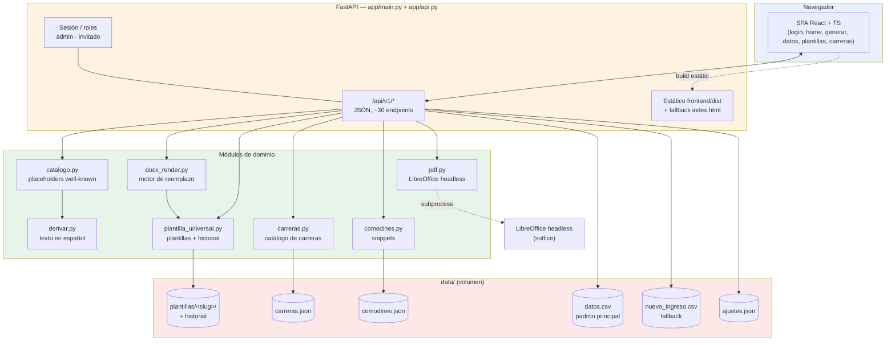
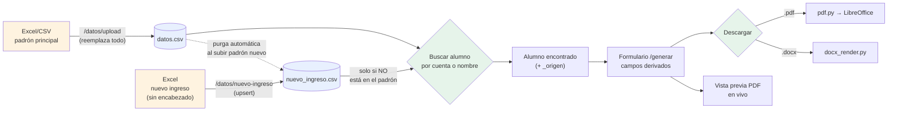
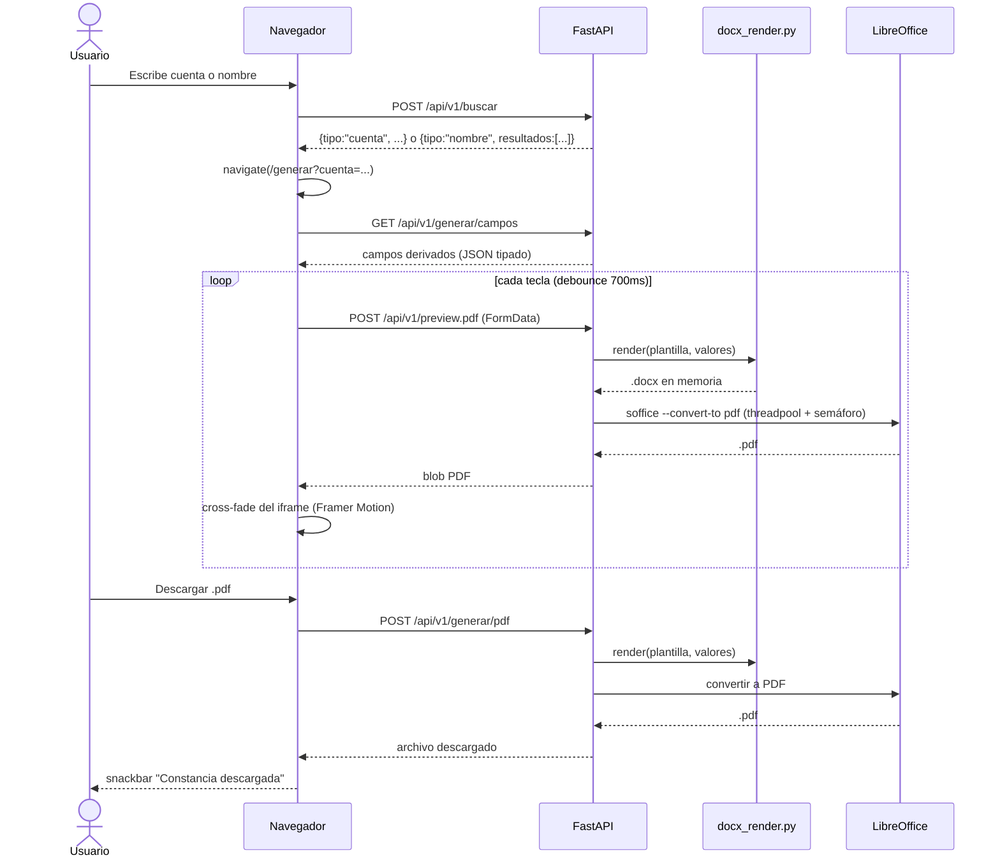

# Documentación técnica — Generador de Constancias UAEM Tianguistenco

Referencia para quien mantenga o extienda el código. Para el manual de uso diario, ver [MANUAL_USUARIO.md](MANUAL_USUARIO.md). Índice general en [INDEX.md](INDEX.md).

## 1. Visión general

Aplicación web en dos partes, sin base de datos: todo el estado vive en archivos CSV/JSON planos bajo `data/` (montado como volumen Docker).

- **Backend**: **FastAPI**, expuesto como API JSON pura bajo `/api/v1/*` (`app/api.py`). Genera constancias escolares en `.docx` (vía `python-docx`) y `.pdf` (vía LibreOffice headless) a partir de una o varias plantillas con placeholders `[[CAMPO]]`.
- **Frontend**: **SPA en React 18 + TypeScript** (`frontend/`), compilada con Vite y servida como estático por el propio FastAPI (con fallback a `index.html` para las rutas del router de React). Usa React Router para las 6 pantallas, TanStack Query para el estado remoto (caché, mutaciones, invalidación) y Framer Motion para las animaciones (transiciones de página, listas escalonadas, cross-fade de la vista previa) — siempre detrás de `useReducedMotion()`.

Principios de diseño que se repiten en todo el código:

- **El nombre del placeholder decide su comportamiento.** No hace falta tocar código para agregar un campo nuevo a una plantilla: las convenciones de sufijo (`_LINEA`, `_FECHA`) y el catálogo `ETIQUETAS` en `catalogo.py` cubren la mayoría de los casos.
- **Nunca se pierde una versión.** Plantillas, padrón y ajustes se escriben de forma atómica (`.tmp` + `os.replace`) y las plantillas llevan historial con restauración de un clic.
- **Backend y frontend desacoplados por una API JSON tipada.** `app/api.py` expone `/api/v1/*`; `frontend/src/api/client.ts` es el único punto de contacto del frontend con el backend, con tipos TypeScript que reflejan las respuestas del servidor.

## 2. Arquitectura



### Módulos (`app/`)

| Archivo | Líneas | Responsabilidad |
|---|---|---|
| `main.py` | ~615 | Lógica de dominio (datos, ajustes, plantillas, generación), sesión/roles, montaje de la API y del estático de la SPA |
| `api.py` | ~410 | Router JSON `/api/v1/*`: handlers delgados sobre la capa de dominio de `main.py`, dependencias de auth (`require_session`/`require_admin`) |
| `catalogo.py` | ~200 | Placeholders "well-known", convenciones por sufijo, derivación de valores por alumno |
| `docx_render.py` | ~210 | Detección y reemplazo de placeholders en cuerpo/tablas/headers/footers/cuadros de texto |
| `plantilla_universal.py` | ~350 | Gestión de plantillas con nombre: historial, cache autovalidada por mtime/tamaño |
| `derivar.py` | ~190 | Texto formal en español: fechas, semestre en letra, género, promedios |
| `carreras.py` | ~160 | Catálogo editable de carreras y duración de planes |
| `comodines.py` | ~50 | Snippets reutilizables para la línea libre, con lock de concurrencia |
| `pdf.py` | ~80 | Conversión `.docx` → `.pdf` vía `soffice --headless` (sync + variante async con threadpool/semáforo para no bloquear el event loop) |

### Frontend (`frontend/`)

SPA en React 18 + TypeScript, compilada con Vite (`npm run build` → `frontend/dist`, servida como estático por FastAPI con fallback a `index.html`). 6 pantallas bajo `frontend/src/pages/`: `Login`, `Home` (búsqueda + estado + atajos por rol), `Generar` (formulario dinámico + vista previa PDF en vivo), `Datos`, `Plantillas`, `Carreras`.

- `frontend/src/api/client.ts` — cliente HTTP tipado, único punto de contacto con `/api/v1/*`; `ApiError` expone el mensaje `{"error": "..."}` del backend.
- `frontend/src/context/ThemeContext.tsx` — toggle de tema claro/oscuro (`localStorage` + `data-theme` en `<html>`), equivalente del antiguo `theme.js`.
- `frontend/src/context/ToastContext.tsx` — snackbars con `aria-live`, equivalente de `avisar()`.
- `frontend/src/context/DialogContext.tsx` — reemplazo accesible de `confirm()`/`prompt()`, con nivel 2 "escribir para confirmar" (bloquea el botón de confirmar hasta que el texto tecleado coincide) — equivalente de `confirmar()`/`pedirTexto()` de `ui.js`.
- `frontend/src/context/TourContext.tsx` — tour guiado (coach marks), equivalente de `tour.js`. Cada pantalla registra sus pasos con `useTourSteps(key, steps)`; el botón de ayuda del `Header` lo relanza.
- `frontend/src/components/` — `Header`, `Icons`, `Notice`, `Stagger` (listas con aparición escalonada vía Framer Motion), `CountUp`, `RequireAuth`/`RequireAdmin` (guards de ruta basados en `/api/v1/session`).
- `frontend/src/styles/tokens.css`, `app.css` — tokens Material Design 3 portados 1:1 del CSS institucional original (verde/oro UAEM, elevaciones, radios, modo oscuro).
- Animaciones: solo Framer Motion (`useReducedMotion()` en cada animación), sin GSAP/Three.js/confeti. Transiciones de página por `AnimatePresence` + `layoutId` compartido entre la tarjeta de búsqueda de Home y la de Generar.

El antiguo frontend Jinja2 + JS vanilla (`app/templates/`, `app/static/`) fue retirado por completo — ver §10.

## 3. Modelo de datos (archivos, no BD)



### `data/datos.csv` — padrón principal

Columnas: `Cuenta, NombreAlumno, Plan, PerInicio, PrmGR, Per, Acr, Crd, Rpr, Sit, PrmAnual` (+ `Sexo` opcional). `NombreAlumno` sigue el formato `"APELLIDOS / NOMBRES"`. Se reemplaza por completo en cada subida (`guardar_datos`); las columnas se emparejan tolerando mayúsculas/acentos/espacios.

### `data/nuevo_ingreso.csv` — fallback de alumnos sin padrón

Se puebla desde un Excel **sin fila de encabezado real** (columnas posicionales: Cuenta, Apellido paterno, Apellido materno, Nombre(s), Plan, Periodo). Se consulta **solo** cuando la cuenta no aparece en el padrón principal — nunca se fusiona. Se purga automáticamente (en ambos sentidos) cuando una cuenta ya presente aparece en el otro archivo, para no dejar duplicados fantasma cuando un alumno avanza de semestre.

### `data/ajustes.json`

Periodo activo, fechas de inicio/fin de semestre, metadatos de la última carga de cada fuente (`datos_*`, `ni_*`).

### `data/carreras.json`, `data/comodines.json`, `data/plantillas/`

Catálogo de carreras editable desde `/carreras`; snippets de línea libre; una carpeta por plantilla (`universal.docx` + `_meta.json` con cache de placeholders + `historial/` con hasta 10 versiones respaldadas).

## 4. Flujo de generación de una constancia



Nota de rendimiento: `pdf.py` crea un perfil de usuario temporal de LibreOffice **en cada invocación** (no hay proceso `soffice` persistente), así que cada conversión tarda ~2-5s por el arranque en frío. La vista previa lo compensa con skeleton + mensajes escalonados, no con progreso granular (no hay infraestructura de streaming en el backend).

## 5. Sistema de placeholders

El nombre del placeholder en el `.docx` decide todo (`catalogo.py:tipo_de`):

| Convención | Comportamiento |
|---|---|
| `[[CUALQUIER_NOMBRE]]` | Input de texto libre |
| `[[ALGO_LINEA]]` / `[[LINEA_LIBRE]]` | Párrafo opcional: textarea + switch; si queda vacío, el párrafo se borra del `.docx` final |
| `[[ALGO_FECHA]]` | Selector de fecha → texto formal corto |
| Well-known (`NOMBRE_COMPLETO`, `CUENTA`, `CARRERA_FULL`, `SEMESTRE_TEXTO`, `SEMESTRES_TOTALES`, `PERIODO_INICIO/FIN`, `FECHA_EXPEDICION`, `ARTICULO`, `INTERESADO_FRASE`, `PROMEDIO_*_LINEA`, `PERIODO_VACACIONAL_LINEA`) | Etiqueta + control específico + valor prellenado, definidos en `ETIQUETAS` (`catalogo.py`) |

`docx_render.py` busca placeholders en cuerpo, tablas (incluso anidadas), headers/footers y cuadros de texto, y **une runs de Word partidos** antes de reemplazar (Word fragmenta el texto internamente al editar).

Para alumnos con `_origen == "nuevo_ingreso"`, `SEMESTRE_TEXTO` se deja vacío deliberadamente en vez de calcularse con `periodo_a_semestre`: el `PerInicio` de ese archivo no siempre representa el semestre real del alumno en este plantel (ver `catalogo.py`, comentario en `_derivar_well_known`).

## 6. Autenticación y roles

Pseudo-login con cookie **sin firmar** (`rol=admin|invitado`, `httponly`, `samesite=lax`) — es solo *gating de UI*, no seguridad real. Las dependencias FastAPI `require_admin`/`require_session` (`app/api.py`) protegen cada endpoint según lo que le corresponde: `require_admin` en administración (subir datos, plantillas, carreras); `require_session` alcanza para comodines y el resto de operaciones de cualquier usuario autenticado. **No exponer el servicio a Internet sin un proxy con TLS + autenticación real** (Basic Auth, OAuth, etc.) — señalado también en el README.

## 7. Endpoints (`app/api.py`, prefijo `/api/v1`)

Todas las respuestas son JSON; los errores tienen la forma `{"error": "mensaje"}` (exception handler en `app/main.py`). Auth vía dependencias FastAPI (`require_session`, `require_admin`) que lanzan `HTTPException(401/403)`.

| Ruta | Método | Rol | Función |
|---|---|---|---|
| `/login`, `/logout`, `/session` | POST/POST/GET | — | Pseudo-sesión por cookie sin firmar |
| `/home` | GET | sesión | Estado agregado: datos, nuevo ingreso, plantillas, ajustes |
| `/ajustes` | POST | admin | Periodo activo y fechas del semestre |
| `/buscar` | POST | sesión | Búsqueda por cuenta o nombre (padrón + nuevo ingreso) |
| `/buscar/nombre` | GET | sesión | Búsqueda incremental por nombre |
| `/datos`, `/datos/upload` | GET/POST | admin | Padrón principal + panel de salud |
| `/datos/nuevo-ingreso`, `/datos/nuevo-ingreso/eliminar` | POST | admin | Archivo secundario de alumnos nuevos |
| `/plantillas`, `/plantillas/crear`, `/plantillas/{slug}/upload\|download\|restaurar\|eliminar` | GET/POST | admin | CRUD + historial de plantillas |
| `/carreras`, `/carreras/carrera*`, `/carreras/duracion*` | GET/POST | admin | Catálogo de carreras |
| `/comodines`, `/comodines/{id}` | GET/POST/DELETE | sesión | Snippets de línea libre |
| `/generar/campos` | GET | sesión | Campos derivados para el formulario de una constancia |
| `/preview.pdf` | POST | sesión | Vista previa PDF en vivo |
| `/generar/docx`, `/generar/pdf` | POST | sesión | Descarga final |

Fuera de `/api/v1/*`, FastAPI sirve el estático de `frontend/dist` (assets con hash + `index.html` como fallback para cualquier ruta no reconocida, para que el router de React resuelva deep links como `/generar` o `/datos`).

## 8. Pruebas

`tests/` (pytest, `TestClient` de FastAPI contra `/api/v1/*` con JSON, sin LibreOffice real — solo se prueba `.docx`): 80 casos cubriendo motor de render, gestión de plantillas, catálogo/derivación, carreras, y un flujo de API de punta a punta (`test_api.py`). Fixtures aíslan cada test con `tmp_path` + monkeypatch de las rutas de datos.

```powershell
python -m venv .venv
.venv\Scripts\pip install -r requirements-dev.txt
.venv\Scripts\python -m pytest tests -q
```

Dos tests (`test_nuevo_ingreso_*`) dependen de un Excel real gitignorado (`data/Alumnos de nuevo ingreso 26B.xlsx`) y se saltan automáticamente (`skipif`) si no está presente — no rompen CI/clones limpios.

El frontend no tiene suite de pruebas propia todavía (`frontend/package.json` deja `vitest` listo como devDependency, pero no hay specs); la verificación end-to-end se hace por ahora ejecutando el backend real y comprobando la API + el build servido, no con pruebas automatizadas de componentes.

## 9. Despliegue

`Dockerfile` multi-stage:

1. **`frontend-build`** (`node:20-alpine`): `npm install` + `npm run build` sobre `frontend/`, produce `frontend/dist`.
2. **Imagen final** (`python:3.11-slim` + `libreoffice-writer`): copia `app/` y **solo** `frontend/dist` de la etapa anterior — Node y `node_modules` no quedan en la imagen final.

Variable `ADMIN_PASSWORD` para la contraseña de admin (default `admin2026`, **cambiar siempre** en producción), volumen `data/` para persistencia. Detalle completo de arranque/actualización/auto-inicio en Windows y Linux (systemd) en el [README](../README.md#ejecución).

Para desarrollo local del frontend con recarga en caliente: `cd frontend && npm run dev` (Vite en `:5173`, con proxy configurado en `vite.config.ts` hacia `/api/v1` en `http://127.0.0.1:8000`, donde debe estar corriendo `uvicorn app.main:app` en paralelo).

## 10. Historial de decisiones relevantes

- **Generación por lotes eliminada.** Existió (`/lote`) pero no se usaba en la práctica; se retiró por completo (endpoints, template, tests, menciones en README) para reducir superficie de mantenimiento.
- **`nuevo_ingreso.csv` como archivo separado, no fusión.** `guardar_datos` trunca el padrón en cada subida; fusionar habría obligado a resubir el Excel de nuevo ingreso cada semestre. El fallback con purga automática resuelve el mismo problema sin ese costo.
- **Sin SSE ni progreso granular.** El cuello de botella real es el arranque en frío de LibreOffice (2-5s), no el parseo de Excel (decenas de ms para cientos de filas); implementar streaming de progreso no tendría beneficio proporcional a su costo para un mantenedor único.
- **Reescritura de Jinja2 + JS vanilla a React + TypeScript.** El frontend original (`app/templates/*.html`, `app/static/`) fue retirado por completo y reemplazado por una SPA en `frontend/`. El backend pasó de renderizar HTML a exponer una API JSON pura (`/api/v1/*`, `app/api.py`); `app/main.py` conservó toda la lógica de dominio intacta (solo cambiaron los handlers que la exponían). Motivación: separar presentación de dominio, habilitar animaciones más ricas (Framer Motion) sin acumular JS ad-hoc, y tipar el contrato cliente-servidor. El tour guiado (`window.TOUR`/`tour.js`) se portó a React como `frontend/src/context/TourContext.tsx` (`useTourSteps` por pantalla + botón de ayuda en `Header`), con el mismo comportamiento: coach-marks posicionados sobre el elemento real, progreso por teclado, y arranque automático una sola vez por pantalla vía `localStorage`.
- **Path traversal en el fallback SPA (corregido).** La primera versión del handler `GET /{full_path:path}` (`app/main.py`) servía cualquier archivo bajo `FRONTEND_DIST` sin normalizar `full_path`, permitiendo leer archivos arbitrarios del servidor (`../../data/datos.csv`, código fuente) sin autenticación. Se corrigió resolviendo la ruta con `os.path.realpath` y verificando con `os.path.commonpath` que sigue dentro de `FRONTEND_DIST` antes de servirla; si no, cae a `index.html` como cualquier ruta desconocida del router de React.
- **Solo Framer Motion para animación.** Se descartó explícitamente cualquier librería de gráficos 3D/WebGL, confeti, tilt o partículas: el proyecto es de trámite administrativo, no un producto de marketing, y una sola librería de animación reduce superficie de mantenimiento para un mantenedor único.
